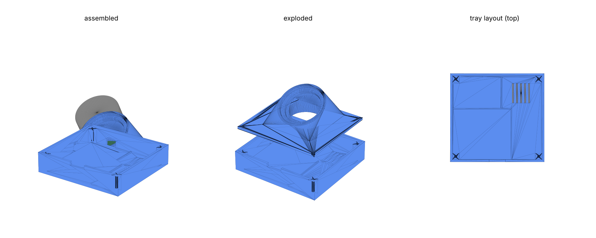

# Timebox Knob

A big, loud, over-engineered timebox timer with a market of exactly one customer. Built from an off-the-shelf ESP32-S3 rotary display, three Adafruit breakout boards, and a two-part 3D-printed enclosure. No soldering.



Turn the knob to set minutes, press to start, the piezo tells you when the box is over. Runs on a 2000 mAh LiPo for roughly 10 hours and charges over USB-C through a window in the back wall.

**Total cost: about $80.** Everything is a plug or a screw terminal. The one part that would need solder (a power switch) is optional and left out of the reference build.

## What's in this repo

| Path | What it is |
|---|---|
| `BOM.md` | Full parts list with part numbers and prices |
| `BUILD.md` | Step-by-step build: print, wire, flash, assemble |
| `enclosure/stl/`, `enclosure/3mf/` | Print-ready files: `lid` (30° cradle) and `tray` (electronics box) |
| `enclosure/src/build.py` | Parametric source. Every dimension is a variable; edit and re-run to regenerate STL/3MF |
| `enclosure/src/standalone_stand_v1.scad` | The original one-piece stand (OpenSCAD), if you only want a tilted holder with no electronics |
| `docs/wiring.png` | Wiring diagram |
| `docs/assembly.png` | Six-step bench assembly card |
| `firmware/pomodoro/` | The timer firmware: liquid-level Pomodoro display, countdown beeps, low power standby |
| `firmware/beep_test/` | Minimal Arduino sketch that proves the beeper works |
| `templates/cardboard_template.pdf` | 1:1 cut-and-fold cardboard version of the enclosure, three Letter pages, for a no-printer prototype |

## Hardware at a glance

- **Knob:** Elecrow CrowPanel 1.28" HMI ESP32-S3 Rotary Display (48 × 48 × 33 mm). Sold on Amazon under several brand names (IoTeikXgo and others); it is the same unit.
- **Power:** Adafruit bq25185 charger with 5 V boost + 2000 mAh LiPo.
- **Beep:** Adafruit PAM8904 piezo driver + 30 mm enclosed piezo.
- **Enclosure:** two PLA parts, printed flat, no supports. Tray 103 × 97 × 23 mm, lid adds the 30° cradle on top. Four M3 screws hold them together.

## Regenerating the enclosure

```bash
pip install trimesh manifold3d numpy matplotlib
cd enclosure/src
python build.py        # writes lid.stl/.3mf, tray.stl/.3mf and enclosure.png next to the script
```

Parameters worth knowing, all at the top of `build.py`:

- `grip_h` — height of the knob's **fixed** base plate. The collar stops 1.5 mm below this so it never touches the rotating body. Measure yours.
- `tilt` — screen angle, default 30°.
- `in_x, in_y, in_z` — tray interior. Widen if you swap in a bigger battery.
- `usb_w, usb_h` — USB-C window in the back wall.

## Things to verify on your own hardware

These are the facts the design could not look up and had to guess at. Each one was labelled as a guess, and two of them were wrong on the first pass:

1. **5 V / GND pin order on the knob's MX1.25 power port.** Check the silkscreen or meter the included USB cable before plugging in. Reversing it will kill the board.
2. **Height of the knob's fixed base plate** (`grip_h`). Designed for ≥ 5.5 mm; if yours is thinner the collar may rub the knob.
3. **Charger board footprint.** Retailers list it anywhere from 30 × 19 mm to 51 × 25 mm; the bay is sized for the larger.

## How this was made

The 3D design, the parts list, the wiring diagram and the fit check were all done in conversation with Claude; the human contribution was the want, the calipers, the credit card and the Scotch tape. The story of the build is in the accompanying article, *A Product Just for One*.

## License

Hardware design files (`enclosure/`, `templates/`): [CERN-OHL-P-2.0](LICENSE-HARDWARE).
Firmware and scripts (`firmware/`, `*.py`): [MIT](LICENSE).
Documentation and images (`docs/`, `*.md`): [CC BY 4.0](https://creativecommons.org/licenses/by/4.0/).
