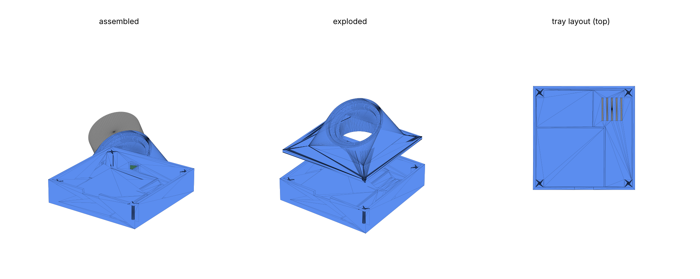

# Enclosure

Two parts, printed flat, no supports. Final files are `stl/lid` + `stl/tray` (same geometry in `3mf/`).

- `tray` — 103 × 97 × 23 mm box. Ribs on the floor mark four bays (battery, amp, charger, piezo), five sound slots under the piezo, USB-C window at floor level in the back wall, switch slot in the left wall, finger notch at the front, M3 corner bosses.
- `lid` — drops flush into the tray. A 30° cradle with a 4 mm ring that supports only the knob's fixed base plate; the rotating body clears it by 1.5 mm. Open floor so the knob's connectors hang straight down into the box.
- `standalone_stand_v1` — the original single-piece tilted holder, no electronics. OpenSCAD source alongside.

`src/build.py` regenerates everything with trimesh + manifold3d. All dimensions are variables at the top of the file.

